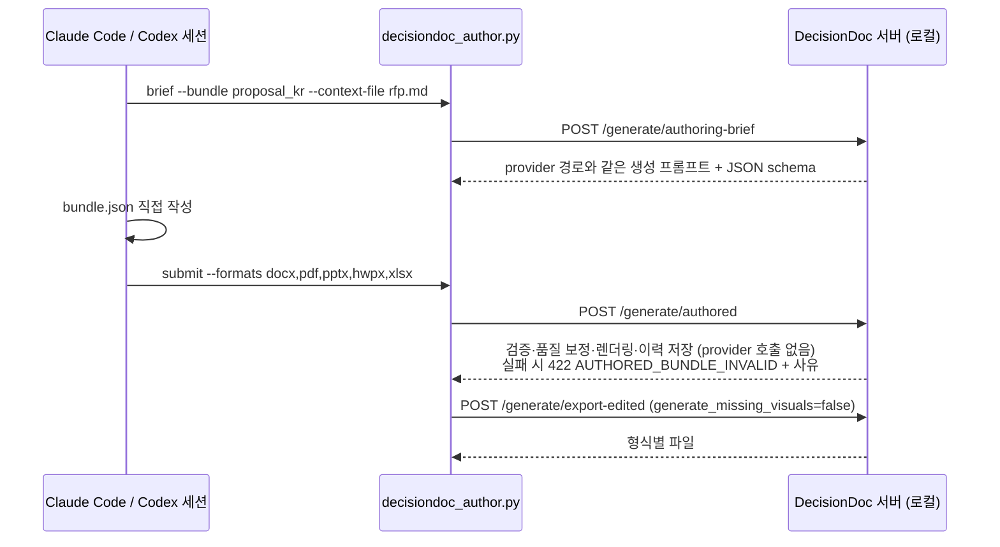
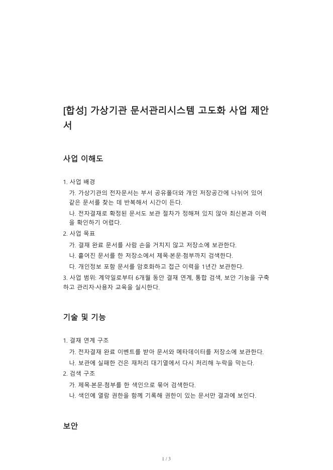
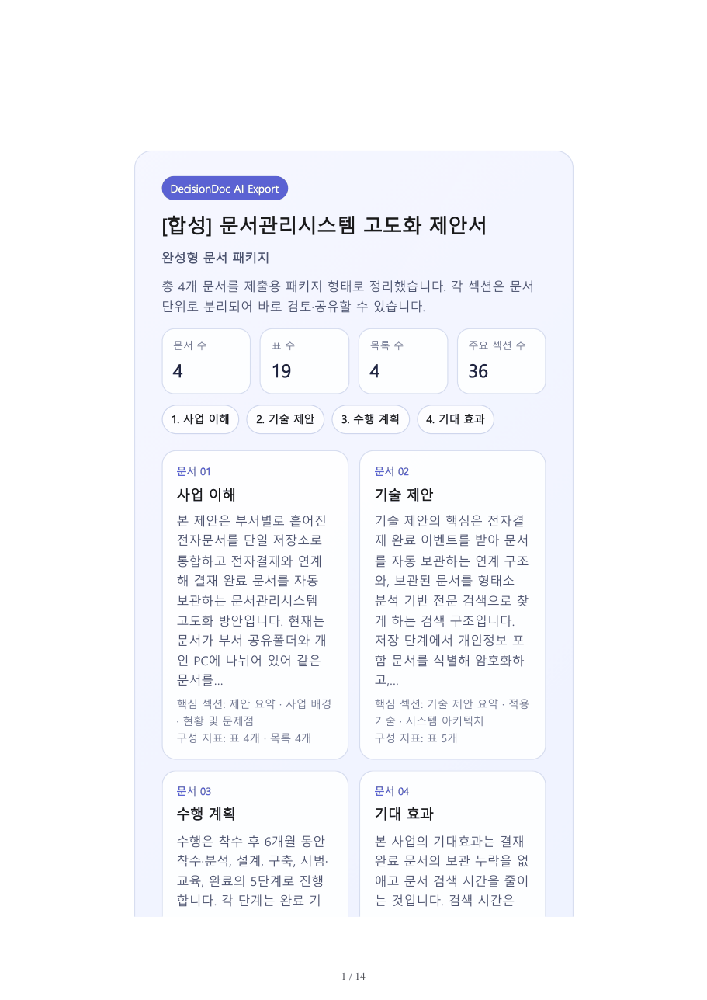
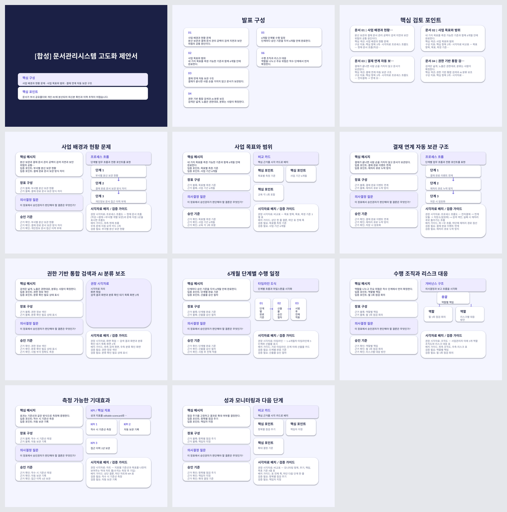
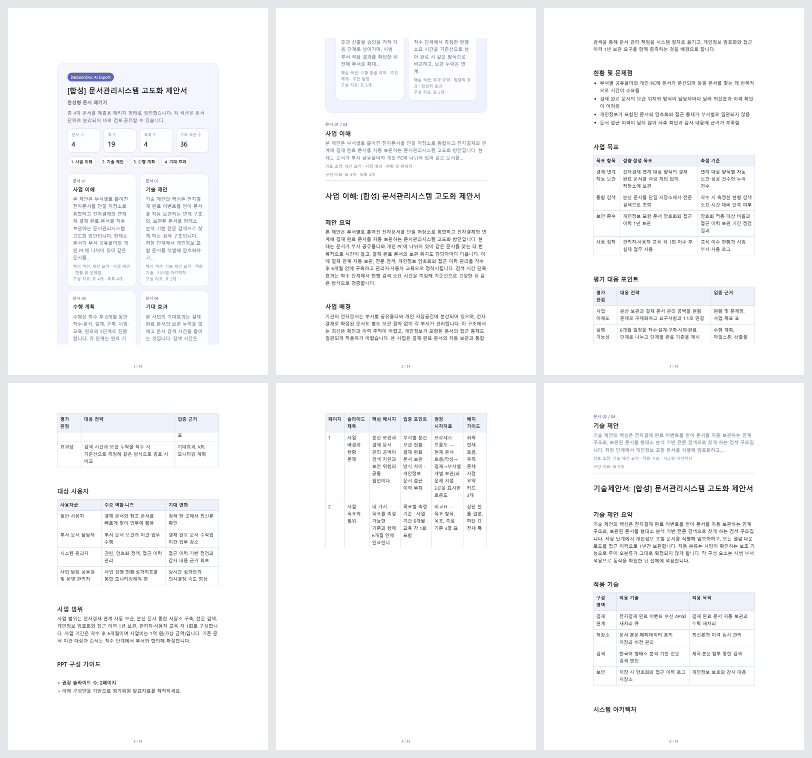
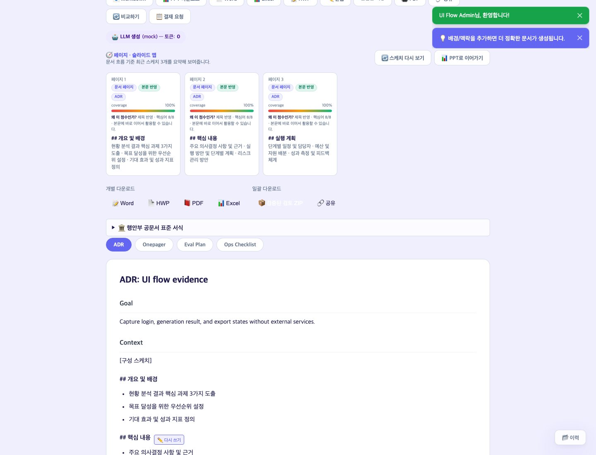

# DecisionDoc AI — 포트폴리오 요약

기준일: 2026-10-21. 이 문서의 모든 주장은 저장소의 코드·테스트·증거 파일로 확인할 수 있는 범위로 제한한다. 현재 CI 결과는 [Development Plan §0](./development-plan.md#0-current-completionreadiness-snapshot)에만 기록하고 여기서 복제하지 않는다.

## 한 줄 소개

공공기관·공기업·지자체·국책과업의 제안서와 보고서를 **RFP와 공식 기준에 대조**하는 로컬 문서 작업 도구. 문서 내용은 사용자의 Claude Code·Codex 세션이 쓰고, DecisionDoc은 다음을 맡는다.

- RFP 조건 정리
- 요구사항 대비표, 평가항목 조견표(제출 PDF 쪽 확인)
- 공공 표기 검사
- 과업 단계 보고서 검사
- 제출 전 검사
- HWPX·DOCX·PDF 변환

| 항목 | 현재 상태 |
|---|---|
| 형태 | 개인 프로젝트. 서버 없는 공공 과업 문서 검사 CLI(`scripts/publicdoc.py`) + FastAPI 서버·정적 PWA·작성 CLI. 로컬 실행 기준 |
| 기능 | 계획한 로컬 기능 구현과 자동 회귀 검증 완료. 기능별 상태는 [Development Plan §0](./development-plan.md#0-current-completionreadiness-snapshot) |
| 아직 아닌 것 | 실제 RFP·사람 사용 검증(UAT) 전, 운영 배포 아님, 사용자 성과 수치 없음 |

## 1. 문제

컨설팅 현장에서 제안서·평가보고서는 작성자 숙련도에 따라 구조와 품질이 달라지고, 같은 목차와 표를 매번 다시 만든다.

Claude·Codex 같은 일반 LLM은 초안을 이미 잘 쓴다. 그래서 문장 생성은 차별점이 아니다. 공공 과업에서 실제로 시간이 들고 실수가 나는 곳은 **대조 작업**이다.

- RFP 요구사항 고유번호를 하나도 빠짐없이 다뤘는지
- 평가항목마다 제안서 몇 쪽에서 답하는지(조견표). 조달청 평가에서는 조견표 등록이 필수다
- 공문서 표기(항목 기호 순서, 날짜·시각, 금액 한글 병기)와 제출 조건(형식, 용량, 별도 파일, 쪽수)을 지켰는지
- 블라인드 평가인데 회사 이름이 본문이나 파일 속성에 남지 않았는지
- 제안서에서 약속한 인력·일정·산출물이 이후 착수·중간·완료보고서와 맞는지
- 근거 없는 수치·일정·금액이 섞이지 않았는지

## 2. 핵심 설계 결정

### 2-1. 생성이 아니라 대조로 특화한다

세션이 RFP를 읽어 **RFP 조건 카드**(요구사항, 평가항목·배점, 지정 목차, 제출 조건, 과업지시서 항목, 제안서 약속)를 쓰면, 서버 없는 CLI가 원고를 그 조건과 공식 기준에 대조한다. 원고는 Markdown·DOCX·HWPX·PDF 어느 것이든 되고, 누가 썼든 같은 방식으로 검사한다.

| 명령 | 대조하는 것 |
|---|---|
| `scan-requirements`, `check-profile` | HWPX·PDF RFP에서 요구사항 번호 후보를 찾고(잡음 접두어 제외), 조건 카드의 누락·불일치를 "확인 필요"로 남긴다 |
| `proposal-skeleton`, `proposal-check` | RFP 지정 목차나 평가항목으로 제안서 뼈대를 만들고, 목차 누락·남은 자리 표시·대응 없는 요구사항을 잡는다 |
| `trace` | 요구사항 대비표. 누락 번호와 RFP에 없는 번호 |
| `crosswalk --pdf` | 조견표. 표지 요약·목차에도 같은 제목이 있으므로, 원고에서 제목 다음 본문이 PDF에서도 뒤따를 때만 그 쪽을 인정한다 |
| `notation` | 항목 기호 순서·단계 건너뛰기, 날짜 온점, 24시각제, 금액과 한글 금액의 일치, "끝" 표시. 행정기관 문서는 오류, 제안서·보고서는 경고 |
| `report-skeleton`, `report-check` | 사업수행계획서(고시 16개 목차) 등 보고서 8종의 섹션과, 과업지시서 항목·제안서 약속을 함께 추적하는 과업 이행 대비표 |
| `submission` | 형식·전체 용량·별도 파일·쪽수, 블라인드 시 본문·파일 이름·메타데이터의 회사 식별 정보, 남은 작성용 흔적 |
| `export` | 서버 없이 HWPX·DOCX·PDF로 변환. DecisionDoc 표지를 넣지 않고 하위 항목 들여쓰기를 유지한다 |

- **근거:** 공식 기준 13종(법령·고시·예규)을 2026-10-19 기준으로 확인해 출처·확인 수준과 함께 기록했다.
  - 확인 수준이 높은 규칙만 코드에 고정했다. 예: 요구사항 분류 11종, 조달청 조견표·PDF·300MB, 사업수행계획서 16개 목차, 공문서 표기.
  - 블라인드·쪽수·보고서 목차처럼 RFP마다 다르거나 공식 근거를 찾지 못한 조건은 조건 카드에서 읽는다. 짐작으로 채우지 않는다.
- 설계 기록: [Public-sector Specialization Design](./superpowers/specs/2026-10-19-public-sector-specialization-design.md)

### 2-2. LLM 출력을 업무 산출물로 다룬다

문서 유형마다 `BundleSpec`이 필수 섹션·JSON schema·작성 지침을 정의한다. 생성 결과는 schema 검증, stabilizer, 품질 보정, Jinja2 렌더링, lint를 거친 뒤에만 저장되고, 저장된 Markdown이 5종 형식 변환의 단일 원본이 된다. 번들은 20종이다(`app/bundle_catalog/registry.py`).

### 2-3. 모델 호출을 서버 밖으로 옮긴다

처음에는 서버가 OpenAI·Gemini·Claude provider를 호출했다. 로컬에서 혼자 쓰는 도구로 방향을 정한 뒤, 이미 구독 중인 Claude Code·Codex 세션이 문서를 쓰고 서버는 나머지를 맡도록 경로를 하나 더 만들었다. API 키와 호출 비용이 필요 없고, 서버 파이프라인은 그대로 재사용한다.

- **같은 지침:** `authoring-brief`는 실제 생성과 같은 준비 단계(문체 예시, 프로젝트 지식, 조달 문맥)를 거친 프롬프트를 돌려준다. 테스트가 provider 경로의 프롬프트와 같은지 확인한다.
- **대체 지점 하나:** `AuthoredBundleProvider`가 provider 호출 자리만 대신하고, 캐시와 웹 검색은 쓰지 않는다. 일반 `/generate` 호출 형태는 바꾸지 않았다.
- **세션 안내:** `.claude/skills/decisiondoc-authoring/SKILL.md`가 세션의 작업 순서와 작성 규칙을 정한다.
- 설계 기록: [Agent-authored Local Generation Design](./superpowers/specs/2026-10-07-agent-authored-local-generation-design.md)

### 2-4. 근거 없는 수치를 만들지 않게 한다

- 모든 번들 프롬프트 끝에 "수치 근거" 규칙을 두고, 다른 지시가 정량 지표를 요구해도 이 규칙이 우선하게 했다(`tests/test_bundle_prompt_rules.py`).
- 짧은 맥락에서 근거 없는 수치가 들어간 필드는 품질 보정 단계가 일반 문장으로 바꾼다.
- 세션 작성 경로를 검증하다가 이 보정 문장이 특정 사업(보행 안전) 문구로 고정돼 있어 다른 주제 문서에 섞이는 결함을 찾았다. 주제 중립 문장으로 고치고 회귀 테스트를 추가했다.

### 2-5. 경계를 섞지 않는다

| 섞기 쉬운 것 | 분리한 방식 |
|---|---|
| 문서 검토 완료 ↔ 외부 제출 승인 | 검토 완료 receipt는 제출·입찰·법적 승인 권한을 갖지 않는다 |
| 원래 생성 이력 ↔ 편집본 | 편집본은 별도 사본으로 저장하고, 생성 발급 이력이 없는 편집본으로는 검토를 만들 수 없다(`409`) |
| 문체 예시 ↔ 모델 학습 | 문체 예시는 프롬프트 참고 자료일 뿐 가중치 학습이 아니다 |
| 다운로드 ↔ 재생성 | Markdown 다운로드는 브라우저에서 처리하고, 형식 변환은 `export-edited`로만 한다. 둘 다 생성 API를 다시 부르지 않는다 |

### 2-6. 상태 파일을 덮어쓰지 않는다

프로젝트·결재·이력·감사 로그 같은 상태를 tenant별 local/S3 object에 두고, 쓰기는 conditional create/CAS로 확정한다. 손상된 파일은 빈 목록으로 숨기지 않고 원본을 보존한 채 중단한다. 상세 범위는 [Contribution Note](./contribution-note.md)에 있다.

## 3. 화면과 산출물

아래 산출물은 모두 합성 데이터로 만들었고 외부 서비스를 호출하지 않았다.

### 3-1. 공공 과업 제안서

합성 제안요청서(HWPX)를 읽어 조건 카드를 쓰고, 평가항목으로 만든 목차에 이 세션이 제안서를 썼다. 그다음 서버 없이 PDF로 내보냈다.

- **표지·소개 카드 없음:** DecisionDoc 표지와 소개 카드가 없고, PDF 속성에도 도구 이름이 없다.
- **들여쓰기 유지:** `가.` 항목이 한 글자 들여 써진다.
- **요구사항 대비표:** [requirement-trace-table.md](../evidence/generated-samples/public-sector/requirement-trace-table.md). 6건 모두 대응이다.
- **조견표:** [crosswalk-table.md](../evidence/generated-samples/public-sector/crosswalk-table.md). 평가항목 5개 모두 본문이 확인된 쪽 번호다.

| 실수를 넣은 제안서 | 검사 결과 |
|---|---|
| 교육 요구사항 번호를 빠뜨림 | `trace`·`proposal-check`가 `PSR-001` 누락 보고 |
| 번호 오타(`SFR-002` → `SFR-004`) | RFP에 없는 `SFR-004`와, 그로 인해 대응이 사라진 `SFR-002`를 함께 보고 |
| 블라인드 평가인데 회사명 기재 | `submission`이 PDF 본문의 회사명을 오류로 보고 |
| 공공 표기와 다른 날짜 | `notation`이 "2026. 11. 2." 표기를 제안 |

### 3-2. 세션 작성 경로

**세션이 작성한 제안서의 PDF 표지** — 합성 RFP를 입력으로 Claude Code 세션이 `proposal_kr` 4개 문서를 작성했다.

**같은 문서의 PPTX 11장** — 구조화 슬라이드로 변환됐다.

**PDF 본문(첫 6쪽)**

**웹 화면의 생성 결과** — mock provider로 생성한 결과. 문서 탭, 페이지 구성, 형식별 다운로드.

## 4. 검증 방법

| 확인 대상 | 방법 | 증거 |
|---|---|---|
| 공공 과업 흐름 | 합성 RFP를 HWPX로 만들어 다시 읽고, 바른 제안서와 실수를 넣은 제안서를 대조한다. 바른 제안서를 내보낸 PDF로 조견표 쪽을 확인한다 | `python3 scripts/capture_public_sector_evidence.py` → [receipt](../evidence/cli-logs/public_sector_evidence.json). 넣은 실수 4건을 모두 잡지 못하거나 바른 제안서가 하나라도 실패하면 receipt 검증이 실패한다 |
| 세션 작성 경로 | 저장소에 둔 작성 결과(`docs/samples/agent_authored_local/bundle.json`)를 임시 데이터 폴더의 앱에 다시 제출. 작성 문장이 결과에 모두 남는지, 5종 형식이 만들어지는지 확인 | `python3 scripts/capture_agent_authored_evidence.py` → [receipt](../evidence/cli-logs/agent_authored_evidence.json): 작성 문장 106개 모두 유지, PDF 14쪽, PPTX 11장 |
| 웹 흐름 | 로그인 → 번들 선택 → 생성 → Markdown 다운로드를 브라우저로 실행. 다운로드 중 생성 API 호출이 0건인지 기록 | `python3 scripts/capture_ui_flow_evidence.py` → [receipt](../evidence/cli-logs/ui_flow_evidence.json) |
| 회귀 | pytest(비 E2E)와 Playwright E2E를 CI에서 별도 단계로 실행 | [Development Plan §0](./development-plan.md#0-current-completionreadiness-snapshot) |
| 격리 | 검증 실행은 `.env`를 읽지 않고, 임시 데이터 폴더와 mock/local 저장소를 쓰며, loopback 외 네트워크를 막은 조건에서 했다 | 같은 문서의 각 기록 |

## 5. 기술 스택과 역할

- **Backend:** Python 3.12, FastAPI, Pydantic v2(strict), Jinja2
- **문서 변환:** python-docx, python-pptx, xlsxwriter, HWPX package writer, Playwright Chromium PDF
- **저장소:** local filesystem·S3 공통 `StateBackend`(conditional create/CAS)
- **테스트:** pytest, pytest-playwright, GitHub Actions
- **공공 과업 검사:** `app/public_sector/`(서버·provider 없이 import됨), `scripts/publicdoc.py`, PyMuPDF·pdfplumber·defusedxml
- **세션 연동:** Claude Code skill(`decisiondoc-authoring`, `public-sector-documents`), Codex `AGENTS.md`, 작성 CLI

개인 프로젝트다. 개발 과정에서 Claude Code·Codex를 개발 도구로 썼고(commit의 `Co-Authored-By` 기록), 변경은 테스트와 CI 통과를 확인한 뒤 merge했다. 직접 설명 가능한 범위는 [Contribution Note](./contribution-note.md)를 기준으로 한다.

## 6. 한계와 다음 단계

| 항목 | 상태 |
|---|---|
| 실제 RFP 사용 확인 | 공공 과업 검사는 합성 RFP로만 확인했다. 실제 기관 RFP의 요구사항 표기와 보고서 양식에 맞는지는 실제 자료로 확인해야 한다 |
| 공공 검사의 판단 범위 | 요구사항 대응은 고유번호 언급으로 판단한다. 내용이 요구사항을 실제로 충족하는지, 로고 이미지 같은 블라인드 위반은 사람이 검토한다 |
| 사람 사용 검증(UAT) | 사전 점검까지 완료. 실제 업무 문서로 쓰는 확인은 남아 있다 |
| 실제 모델의 문서 품질 | 이 저장소의 증거는 합성 입력 1건과 mock 생성이다. 품질을 일반화하지 않는다 |
| Live provider·G2B 실데이터·운영 배포 | 비용·자격 증명이 필요해 보류했다. 실행 순서는 [completion-readiness-runbook.md](./completion-readiness-runbook.md) |
| 성과 수치 | 측정하지 않았다 |
